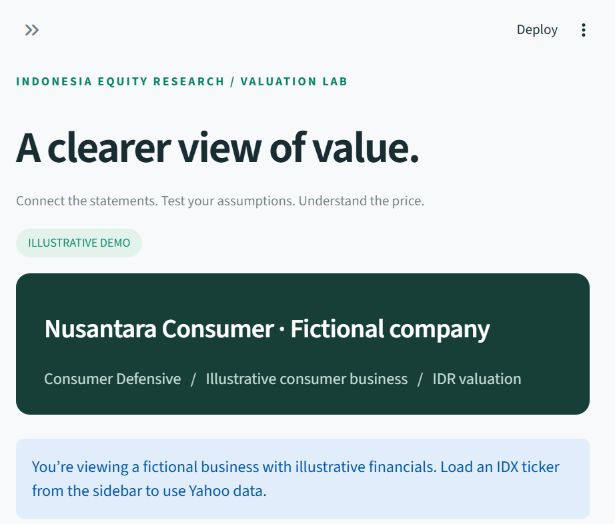

# Nusa — IDX Valuation Lab

A local Python/Streamlit equity research and 3-statement valuation workspace for Indonesian Stock Exchange (IDX) listed operating companies.



## Project Structure

```text
├── app.py                  # Main Streamlit web application & UI tabs
├── valuation/
│   ├── data.py             # Financial statement ingestion & normalization
│   ├── model.py            # 5-year explicit pro-forma forecast, DCF, sensitivity & peer multiples
│   ├── export.py           # Populated Excel (.xlsx) valuation model with dynamic formulas & dashboard
│   └── storage.py          # Local SQLite persistence for saved analyses
├── tests/
│   ├── test_app.py         # End-to-end Streamlit UI & persistence tests
│   └── test_model.py       # Accounting linkage, DCF math & validation unit tests
├── .streamlit/config.toml  # Theme and loopback server configuration
├── requirements.txt        # Python package dependencies
├── start.cmd / start.ps1   # One-click Windows launchers
└── app-preview.png         # Application preview screenshot
```

## Repository Branches

- **`checkpoint` / `checkpoint-baseline`**: Stable baseline release using `yfinance` statements and strict opening balance verification.
- **`master`**: Experimental integration branch incorporating direct IDX XBRL/Excel scraper capabilities (`valuation/idx_scraper`).

## Run

From this folder in PowerShell:

```powershell
.\.venv\Scripts\python.exe -m pip install -r requirements.txt
.\.venv\Scripts\python.exe -m streamlit run app.py
```

Open http://localhost:8501. You can also double-click `start.cmd`, or run `./start.ps1`.

## Workflow

1. Explore the explicitly fictional demo or enter a four-character IDX ticker.
2. In **Data review**, check historical figures, currency, missing values, shares, and price. Correct opening inputs as needed. Expenses are positive. Monetary inputs use IDR billion; shares use billion units.
3. Adjust assumptions in the sidebar and click **Apply assumptions**. Edit individual years under **5-year model**; **Reset annual overrides** restores the sidebar-driven trajectory.
4. Inspect linked statements, funding requirements, DCF, scenarios, and sensitivity.
5. Under **Relative valuation**, fetch up to eight IDX peers. Select peers, enter foreign-currency conversions and enterprise-value adjustments where needed. Comparisons require the exact same annual fiscal period; incompatible periods are excluded.
6. Save locally or export an Excel values snapshot. Saved analyses include the source snapshot, opening corrections, drivers, assumptions, price/shares, and peer snapshot. Excel exports feature an executive Dashboard, fully populated actual financial figures, and live dynamic audit-trail formulas.

## Model conventions

- Historical source statements remain available separately from user corrections. Missing values are not silently zeroed; modelling is blocked until corrected or explicitly accepted as zero.
- Three statements are linked through working capital, PPE, debt, dividends, retained equity, and cash. Opening balance sheet must balance. No balancing plug is inserted.
- D&A is a percentage of opening PPE, capped at available PPE. Interest uses opening debt. Capex is a revenue percentage. Other non-current assets/liabilities are fixed.
- Explicit revolver draws fund cash shortfalls. Repayments retire short-term debt first. Excess cash remains on balance sheet. This is a simplified financing policy, not a credit-capacity assessment.
- FCFF = EBIT × (1 − tax rate) + D&A − capex − change in operating working capital.
- Terminal FCFF = Year 5 NOPAT × (1 + g) × (1 − g / terminal ROIC). Explicit discounting covers Years 1 through 5; Terminal Value is discounted to present value using Year 5 WACC discounting ((1 + WACC)^5). WACC must exceed growth; terminal ROIC must exceed growth.
- Enterprise-to-equity bridge uses opening cash, debt, additional non-operating assets, and other claims. Opening equity includes minorities where supplied; enter the minority claim separately in valuation. Current or user-supplied diluted shares stay fixed.
- Annual year-end discounting starts at the last reported fiscal year. No current-date stub-period adjustment. This makes the quoted-price comparison approximate when reports are old.
- P/E uses reported net income. Review non-controlling and preferred claims for affected companies. Peer EV uses debt including leases where supplied, cash, and a user-entered net adjustment. Comparability must be reviewed by the analyst.
- Scenario bear/bull shift every year's revenue growth and EBIT margin by -/+2 percentage points, retaining all other assumptions.
- Banks, insurers, and REITs are excluded. No NOL, deferred tax, acquisition, segment, future dilution, detailed lease, or FX projection schedules.

## Data

yfinance annual income, balance sheet and cash-flow statements are aligned by exact fiscal date. Only common periods are used. Financial data currency and share-price currency are checked separately. Non-IDR statements require an explicit FX rate; a single rate converts history in this prototype. Data is cached for an hour; clear the cache and reload for fresh data.

Yahoo data availability varies. Provider errors do not switch the app to fabricated financials. The demo is always labeled fictional. yfinance is unofficial and its project describes Yahoo access as intended for personal use: review applicable rights before public or commercial deployment.

Local analyses and Yahoo cache live under `data/` (ignored by Git). The app listens on loopback only and has no account/authentication layer. Do not expose it publicly as-is.

## Verify

```powershell
.\.venv\Scripts\python.exe -m pytest -q
```

Tests cover accounting linkage, funding, debt retirement, valuation direction, invalid assumptions, missing source data, comparable denominators, exports, and the Streamlit demo.
